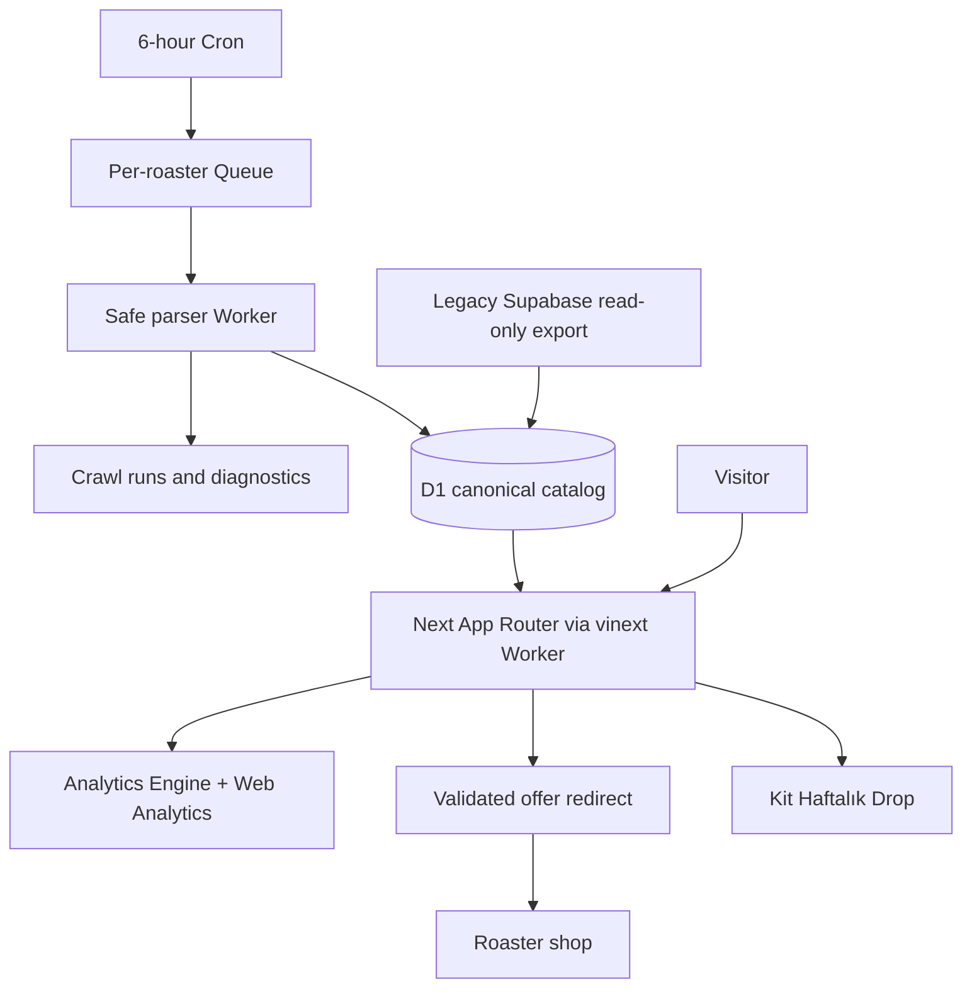

# Cloudflare deployment

## Targets and architecture

Isolated staging account: existing connected owner account; D1 coffeedb-v2-staging, ID 5090f52d-546e-4ba6-bdcd-b4ee531a29a3, read replication disabled. Web Worker coffeedb-v2-web-staging and separate crawler coffeedb-v2-crawler-staging. Queues coffeedb-v2-crawls-staging and coffeedb-v2-crawls-dlq-staging created 2026-09-14. Cron every six hours, guarded by CRAWLS_ENABLED=false until migration gates pass; baseline event suppression initially. No production DNS or scheduler changes.

| Old | V2 replacement | Rollback |
|---|---|---|
| Vercel Next hosting | Workers + vinext beta9 | Existing Vercel deployment retained |
| Supabase catalog/Postgres | D1 SQLite canonical tables | Original DB retained |
| GitHub scheduled scraper | Cron + Queues consumer | Existing Actions schedule untouched until stability |
| Vercel Analytics/coffee clicks | Cloudflare Web Analytics + Analytics Engine offer clicks | Historical analytics retained |
| No subscriber system | Kit email-only form | Subscriber system independent of catalog rollback |

## Framework checks
Current upstream Cloudflare guide recommends vinext, beta requiring compatibility check. Original Next16.2.6 retained; init added vinext1.0.0-beta.9, @vinext/cloudflare beta7, Vite/Cloudflare plugin, React19.3 matching RSC peer requirement. Original Next commands remain. Final Next and Workers web builds pass; real remote browser and queue evidence is linked below. Node22.23.2 used for V2 checks. Regenerate Next route types before TS because vinext also writes route types. No data-cache/KV/image service added. Existing images unoptimized; font behavior requires browser check.

## Commands
Use Node22 and npm ci, then npm run types:cloudflare, npm run db:migrate:local, npm test, npm run typecheck, npm run lint, npm run build, npm run build:cloudflare, npm run build:crawler. Local workerd: npm run dev:cloudflare. Before deployment, check wrangler whoami and exact target. Current local OAuth scopes lack D1/Queues write; connector can manage those staging resources. Do not broadly reauthorize without need.

Remote migration: npm run db:migrate:staging when scoped credential supports D1, otherwise use connector with reviewed SQLite statements and migration checksum ledger. Import/reconcile per d1-migration-runbook. Deployment: built dist/server/wrangler.json via Wrangler deploy after reviewing flattened target config. Crawler via wrangler deploy --config wrangler.crawler.jsonc, initially disabled. Workers Builds: link existing Git repository and 001-kahvedrop-v2 staging branch; build npm ci && npm run build:cloudflare; deploy npx wrangler deploy --config dist/server/wrangler.json. Account repo connection may require owner authorization. Never silently use production branch/hostname.

## Secrets and configuration
KIT_FORM_ID=9918321, KIT_API_KEY secret server-only; NEXT_PUBLIC_SITE_URL must be chosen actual domain or staging URL. Brand working only. Cloudflare account/D1/Queue identifiers are nonsecret. Analytics Engine binding ANALYTICS; Web Analytics token configured for the exact staging hostname; its script is blocked by this computer's DNS filter. SUBSCRIBE_LIMITER and EVENT_LIMITER bindings. No emails/full URLs/UTMs/request bodies in product telemetry; request invocation logs disabled. Review traces/log retention and sampling.

Sources checked 2026-09-14: https://developers.cloudflare.com/workers/framework-guides/web-apps/nextjs/ ; https://developers.cloudflare.com/queues/configuration/batching-retries/ ; https://developers.cloudflare.com/workers/runtime-apis/bindings/rate-limit/ ; https://developers.cloudflare.com/analytics/analytics-engine/get-started/ .

## Production checklist (not configured)
No production env block exists; do not invent resource IDs. A production deploy needs its own:
- D1 database (name + ID) for both Workers, its migrations applied, and the `db:migrate`/refresh/backup workflows pointed at it.
- Queues: main crawl queue and its DLQ; crawler var `CRAWL_DLQ_QUEUE` must equal the main consumer's `dead_letter_queue`.
- Web vars: `DEPLOYMENT_STAGE=production` (also namespaces the catalog read cache), `NEXT_PUBLIC_SITE_URL` at build and as a runtime var (the web Worker throws at startup without it), Web Analytics token/host, `KIT_FORM_ID`.
- Secrets: `KIT_API_KEY`. Analytics Engine dataset; rate-limit namespace IDs.
- Crawler vars: `CRAWLS_ENABLED`, `CRAWL_MODE`; worker names without the `-staging` suffix.

## Deployed staging evidence — 2026-09-15 Istanbul

Web: https://coffeedb-v2-web-staging.hellobasalt.workers.dev, deployment 651be3b2-9e3d-4dad-8974-05e662d5d390 followed by Kit secret upload. Crawler: https://coffeedb-v2-crawler-staging.hellobasalt.workers.dev, version 92c0f8c0-18eb-44c4-b47a-98184f7bc553. Analytics Engine was enabled through the authenticated dashboard and dataset coffeedb_v2_staging contains all seven expected QA event types. CWA site 8e122cb650b5451891d84327f7c98e1e is dedicated to the staging host. No production routing changed.

Fourteen qualified sources completed real remote baselines. Three also completed repeated baseline/live checks; queues and DLQ were empty at the final check. CRAWLS_ENABLED=false and CRAWL_MODE=baseline are restored. The ongoing provider incident did not prevent these verified jobs; earlier incident-blocked notes are historical.

The Vite plugin creates dist/server/.dev.vars for local preview. Both build:cloudflare and build:vinext now invoke scripts/v2-sanitize-build.mjs to remove generated local credential files before release. A rebuilt artifact contained zero copies of the actual Kit key. Keep the root ignored .dev.vars at mode0600 and upload the key through secret stdin, never a command argument. Production-like local preview needs its own intentional secret setup after cleanup.

[Acceptance matrix](staging-acceptance.md), [browser](evidence/p9-web-browser.md), [live integrations and stored events](evidence/p9-integration.md), [queue cycles](evidence/p9-queue-cycles.md), [full baselines](evidence/p9-qualified-baselines.md).
