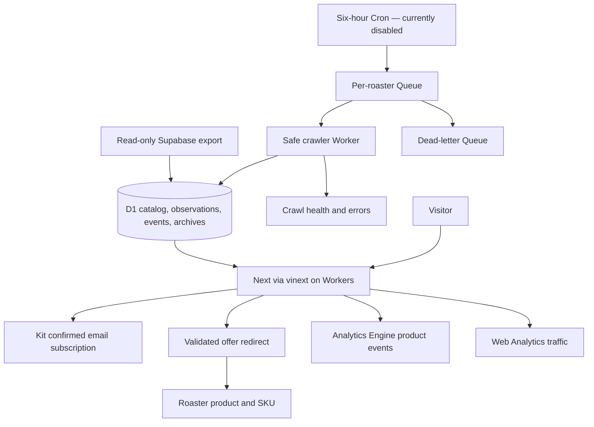

# KahveDrop V2 handoff

2026-09-15, Europe/Istanbul. [Open staging](https://coffeedb-v2-web-staging.hellobasalt.workers.dev).

V2 is deployed to isolated Cloudflare staging with a reconciled catalog, Turkish discovery UI, confirmed Kit signup and measured roaster referrals. The live catalog has 481 available coffees, 38 represented roasters and 1,170 available offers. All original 1,030 identities and 13,452 archives remain intact. Fourteen adapters completed real source baselines. This is ready for owner review; production cutover, domain registration, acquisition and personalization have not occurred.

The test suite, lint, Next and scraper typechecks, Next and Workers builds passed. Actual remote browser tests and Analytics Engine queries cover the working product paths. The complete [acceptance matrix](staging-acceptance.md) distinguishes implemented behavior, real evidence and remaining limits.

## Architecture and infrastructure

The Next App Router UI runs through vinext on Workers. D1 stores canonical coffee identities, SKU offers, immutable observations, discovery events and separately versioned inferred features. A separate crawler Worker consumes bounded per-roaster queue jobs, with atomic ingestion, idempotency, failure health and baseline event suppression. The six-hour Cron is configured but currently disabled. Kit owns subscriber records; D1 does not store email. First-party anonymous product events go to Analytics Engine; Web Analytics is separately configured for page traffic.

| Previous component | V2 component | Retained rollback |
| --- | --- | --- |
| Vercel Next hosting | Cloudflare Worker with vinext | Existing deployment |
| Supabase catalog | D1 canonical catalog and archives | Original database |
| GitHub scheduled scraper | Cron + Queues + crawler Worker | Existing scheduler, unchanged |
| Vercel Analytics / legacy clicks | Web Analytics + Analytics Engine | Historical analytics |
| No subscriber capture | Kit email-only confirmation form | Kit independent of catalog rollback |

## Deliverable index

| Requested deliverable | Canonical artifact |
| --- | --- |
| Repository audit | [V2 audit](v2-audit.md) |
| Final D1 schema | [Catalog migration](../migrations/d1/0001_catalog.sql), [queue idempotency migration](../migrations/d1/0002_queue_job_idempotency.sql) |
| Raw versus inferred versus user data | [Data quality](data-quality.md), [future data boundaries](personalization-roadmap.md) |
| Supabase → D1 migration report | [Migration runbook and reconciliation](d1-migration-runbook.md), [14-source final evidence](evidence/p9-qualified-baselines.md) |
| Data-quality report | [Data quality](data-quality.md) |
| Crawler-health report | [Crawler health](crawler-health.md), [comparison](crawler-comparison.md), [repeated cycles](evidence/p9-queue-cycles.md) |
| Event-engine rules | [Event engine](event-engine.md) |
| Cloudflare deployment instructions | [Deployment](cloudflare-deployment.md) |
| Kit setup and owner actions | [Kit setup](kit-setup.md), [confirmed test](evidence/p7-kit.md) |
| Environment/secrets checklist | [Environment checklist](environment-checklist.md) |
| Analytics dictionary | [Analytics events](analytics-events.md), [actual receipt table](evidence/p9-integration.md) |
| User-research hypotheses | [Research plan](user-research.md) |
| Remaining issues | [Acceptance matrix](staging-acceptance.md) |
| Rollback procedure | [Cutover and rollback](cutover-runbook.md) |
| Next ten tasks, ranked | [Growth plan](growth-plan.md) |
| Branding/domain research | [Brand research and exact checked quotes](branding-research.md) |
| Personalization recommendation | [Personalization roadmap](personalization-roadmap.md) |

Raw facts remain in canonical raw metadata and source archives. Derived values are separate `coffee_feature_values` with provenance, parser/version, reference and optional confidence. Unknowns are retained; crawlers cannot claim manual provenance or overwrite reviewed manual values. Future user preferences and tried/liked interactions remain separate proposed entities. No current percentage match or synthetic taste history is presented.

## Final route map

| Route | Purpose |
| --- | --- |
| `/` | Discovery home, changes and two newsletter placements |
| `/yeni` | Genuine new/restock feed |
| `/firsatlar` | Validated same-offer price drops/deals |
| `/kahveler` | Catalog and advanced filters |
| `/kahve/[slug]` | Durable detail, packages, observations and provenance |
| `/kavurucular`, `/kavurucu/[slug]` | Roaster directory and catalog |
| `/quiz`, `/compare`, `/guide`, `/rankings` | Retained secondary utilities |
| `/go/[offerId]` | Trusted roaster redirect and eligible click event |
| `/api/catalog` | Canonical catalog reads |
| `/api/subscribe` | Native email-only Kit integration |
| `/api/events` | Strict anonymous product events |
| `/privacy`, `/terms` | Product disclosures; final owner review pending |
| `/robots.txt`, `/sitemap.xml`, social images | Metadata; staging remains noindex |
| `/coffees`, `/coffees/[slug]`, `/roasters`, `/roasters/[slug]` | Legacy permanent redirects, preserving supported parameters |
| `/api/click`, `/api/correction-report` | Retired with 410 on V2 |

## Product test and next decision

The catalog is reconciled and unknown-safe within its disclosed coverage. New/deal/restock rules have meaningful tests and do not manufacture an active feed from an import. Current baselines and the unchanged live cycle correctly produced zero discovery events; genuine future transitions are needed to populate these feeds. Mobile discovery/filtering works, an actual one-click referral opened the correct Petra SKU, and the owner confirmed the newsletter. All seven product event types—including that outbound click—are stored in Analytics Engine. QA traffic demonstrates measurement, not qualified commercial demand or purchases.

Remaining limits: 25 legacy sources are paused/unqualified; rapid checks do not establish 18-hour scheduled reliability; separate Web Analytics traffic receipt is blocked by this computer's DNS filter; final domain, branded sender/privacy decisions, full production backup/sync and cutover approval are outstanding. No remote positive price-change or deliberate failure/DLQ injection was performed. Existing production remains available for rollback. Work is local and uncommitted; remote CI has not run.

**Do not start full personalization yet.** Use the ranked growth plan to validate repeat discovery and retention across at least four useful editions and past-behavior interviews. Subscriber targets alone are insufficient. The architecture preserves the necessary data boundaries, but there is no user evidence yet that accounts, persistent taste profiles or a journal improve outcomes.
